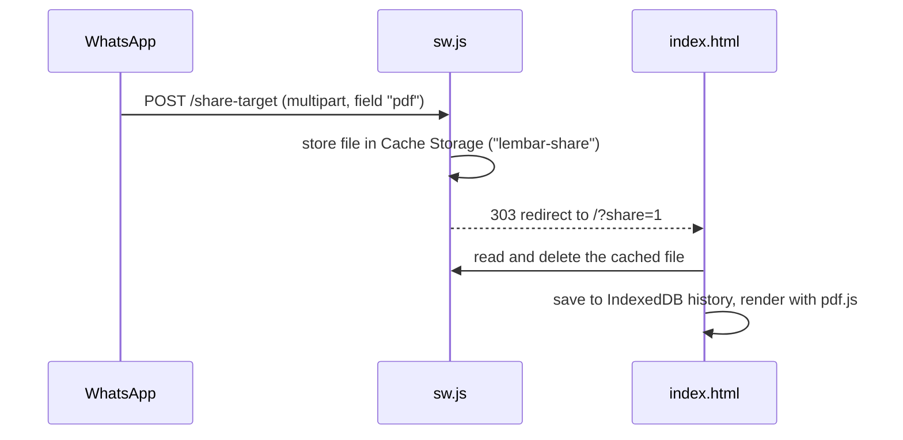
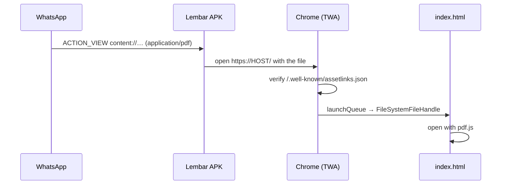

# Lembar

A lightweight PDF reader for Android, built as an installable PWA with an optional Android app wrapper. Tap a PDF in WhatsApp and pick **Lembar** in "Open with" (Android app), or use **Share → Lembar** (PWA). Read offline and pick up where you left off.

Everything runs on the device. Files are never uploaded anywhere.

<p>
  
</p>

## Features

- **Reading:** continuous scroll, pinch-to-zoom, fit-to-width, page slider, jump to page, tap to hide the toolbars
- **Zoom remembered per document**, stored relative to fit-width so it carries over between phone, tablet and rotation
- **Two-page spread** on tablets and in landscape (automatic at 900px+ wide, or forced on/off with the view button). Page 1 stays alone like a book cover.
- **Open from other apps:** "Open with" for PDFs via the Android app (TWA), and the share sheet via the Web Share Target
- **Recently read:** thumbnails, progress, and auto-resume at the last page (keeps the 15 most recent files)
- **Search:** full-text search across all pages, with result snippets and in-page highlights
- **Bookmarks** per document, plus the PDF's own table of contents when it has one
- **Night mode:** inverts page colours for reading in the dark
- **Offline:** app shell and pdf.js are precached by the service worker
- **Password-protected PDFs** are supported
- On desktop Chrome/Edge, the installed app also registers as a `.pdf` file handler

## How sharing from WhatsApp works



If the service worker is not active yet, `src/worker.js` catches the POST on Cloudflare and redirects to `/?share=error` instead of returning a 405.

## Tech

- Vanilla HTML/CSS/JS in one `index.html`. No framework, no build step.
- [pdf.js](https://github.com/mozilla/pdf.js) 3.11.174, vendored in `public/vendor/` so it works offline
- IndexedDB for file history and bookmarks, `localStorage` for the night-mode preference
- Service worker: precached shell, stale-while-revalidate updates, Share Target receiver

## Project structure

```
.
├── public/                  # deploy this folder as-is
│   ├── index.html           # the whole app
│   ├── sw.js                # service worker (offline + share target)
│   ├── manifest.webmanifest # install metadata, share_target, file_handlers
│   ├── _headers             # Cloudflare cache/content-type headers
│   ├── sample.pdf           # built-in guide document
│   ├── icons/               # any + maskable icons (192, 512)
│   └── vendor/              # pdf.min.js, pdf.worker.min.js
├── src/
│   └── worker.js            # Worker: serves public/, assetlinks.json, share fallback
├── android/
│   └── twa-manifest.json    # Bubblewrap config for the Android app
├── .github/workflows/
│   └── android.yml          # builds and signs the APK
├── deploy/
│   └── Caddyfile            # alternative: self-host behind Caddy
└── wrangler.toml            # Workers + static assets config
```

## Run locally

```bash
python3 -m http.server 8080 -d public
# or: npx serve public
```

Open http://localhost:8080. Service workers are allowed on `localhost`. Anywhere else they need HTTPS.

## Deploy to Cloudflare Workers

The app is deployed as a Worker with [static assets](https://developers.cloudflare.com/workers/static-assets/). `wrangler.toml` serves `public/`, and `public/_headers` sets the cache and content-type headers.

**Option A: Git integration (recommended)**

1. Cloudflare dashboard → **Workers & Pages** → **Create** → **Import a repository** → pick this repo.
2. Build settings:
   - Build command: *(leave empty)*
   - Deploy command: `npx wrangler deploy`
3. Make sure `name` in `wrangler.toml` matches the Worker's name in the dashboard (currently `pdf-reader`).
4. Every push to `main` redeploys automatically.
5. Optional: **Settings → Domains & Routes** → add a custom domain such as `lembar.erwarx.com`.

**Option B: from your machine**

```bash
npx wrangler deploy
```

Test locally with the same runtime:

```bash
npx wrangler dev
```

### Self-hosting instead

Copy `public/` to the server and use `deploy/Caddyfile`. Caddy handles HTTPS automatically.

## Install on Android

1. Open the deployed URL in **Chrome for Android**.
2. Tap **Install** on the page (or ⋮ → *Install app*). It has to be a real install, not "Add to Home screen", because only installed WebAPKs appear in the share sheet.
3. In WhatsApp: long-press a PDF → **Share** → **Lembar**.

## Android app ("Open with" from WhatsApp)

A PWA can't appear in Android's "Open with" list, so the repo also builds a small Android app: a [Trusted Web Activity](https://developer.chrome.com/docs/android/trusted-web-activity) made with [Bubblewrap](https://github.com/GoogleChromeLabs/bubblewrap). It runs this same site full-screen in Chrome and registers as a handler for `application/pdf`. When you tap a PDF, Chrome passes the file to the page's `launchQueue`, which `index.html` already reads.



### One-time setup

The app opens **https://lembar.erwarx.com** (set in the workflow; a `TWA_HOST` repository variable overrides it). `wrangler.toml` already holds the signing certificate's fingerprint, so the Worker serves `/.well-known/assetlinks.json`.

The only thing GitHub needs is the signing key, as two repository secrets (*Settings → Secrets and variables → Actions → Secrets*):

- `ANDROID_KEYSTORE_BASE64`: the keystore file, base64-encoded (`base64 -i lembar.keystore` on macOS, `base64 -w0 lembar.keystore` on Linux)
- `ANDROID_KEYSTORE_PASSWORD`: the keystore password

Keep a backup of the keystore and password somewhere safe. Every future update must be signed with the same key, or Android will refuse to install it over the old version.

#### Rotating the key

Create a new one, update both secrets, and replace `TWA_SHA256` in `wrangler.toml` (both `[vars]` and `[previews.vars]`) with the new fingerprint. Phones with the old build have to uninstall it first.

```bash
keytool -genkeypair -keystore lembar.keystore -storetype PKCS12 -alias lembar \
  -keyalg RSA -keysize 2048 -validity 10000 -dname "CN=Lembar"
keytool -list -v -keystore lembar.keystore -alias lembar | grep SHA256
```

### Releasing

Push a tag such as `v1.0.0`. The workflow builds a signed APK and attaches it to a GitHub Release. Download it on the phone, open it, and allow installing from that source when Android asks.

Pull requests that touch `android/` build a test APK signed with a throwaway key. It's useful to check that the build works, but not for installing.

### Requirements on the phone

- Chrome installed and up to date (the TWA runs inside it)
- Android 7.0+ (`minSdkVersion` 24, required by androidbrowserhelper)

## Releasing an update

Bump `VERSION` in `public/sw.js` (e.g. `lembar-v4`) on every deploy that changes cached files. This makes the old cache get dropped. `sw.js`, `/` and the manifest are served with `Cache-Control: no-cache`, so clients pick up the new worker on their next visit.

## Known limitations

- **"Open with" needs the Android app.** Chrome on Android doesn't support `file_handlers` for installed PWAs, so only the TWA build appears there. The plain PWA gets the share sheet.
- **iOS** supports neither "Open with" nor share targets for web apps. Use the in-app **Buka PDF** button.
- **Scanned PDFs** are images with no text layer, so search finds nothing in them.
- **Storage is per browser.** History and bookmarks live in that browser's IndexedDB and are lost if site data is cleared.
- **Fonts** load from Google Fonts and are cached after the first visit. On a cold offline start, system fonts are used.

## Roadmap

- [x] TWA wrapper (Bubblewrap) + `/.well-known/assetlinks.json` for "Open with"
- [x] Remember zoom level per document
- [x] Two-page spread on tablets / landscape
- [ ] Publish the Android app on Google Play
