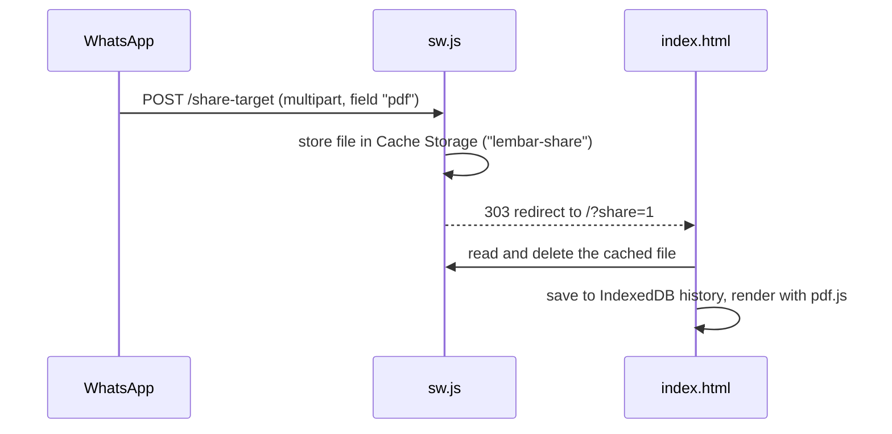

# Lembar

A lightweight PDF reader for Android, built as an installable PWA. Open a PDF straight from WhatsApp (or any app) via **Share → Lembar**, read it offline, and pick up where you left off.

Everything runs on the device. Files are never uploaded anywhere.

<p>
  
</p>

## Features

- **Reading:** continuous scroll, pinch-to-zoom, fit-to-width, page slider, jump to page, tap to hide the toolbars
- **Open from other apps:** registers as a Web Share Target, so it shows up in the Android share sheet once installed
- **Recently read:** thumbnails, progress, and auto-resume at the last page (keeps the 15 most recent files)
- **Search:** full-text search across all pages, with result snippets and in-page highlights
- **Bookmarks** per document, plus the PDF's own table of contents when it has one
- **Night mode:** inverts page colours for reading in the dark
- **Offline:** app shell and pdf.js are precached by the service worker
- **Password-protected PDFs** are supported
- On desktop Chrome/Edge, the installed app also registers as a `.pdf` file handler

## How sharing from WhatsApp works



If the service worker is not active yet, `src/worker.js` catches the POST on Cloudflare and redirects to `/?share=error` instead of returning a 405.

## Tech

- Vanilla HTML/CSS/JS in one `index.html`. No framework, no build step.
- [pdf.js](https://github.com/mozilla/pdf.js) 3.11.174, vendored in `public/vendor/` so it works offline
- IndexedDB for file history and bookmarks, `localStorage` for the night-mode preference
- Service worker: precached shell, stale-while-revalidate updates, Share Target receiver

## Project structure

```
.
├── public/                  # deploy this folder as-is
│   ├── index.html           # the whole app
│   ├── sw.js                # service worker (offline + share target)
│   ├── manifest.webmanifest # install metadata, share_target, file_handlers
│   ├── _headers             # Cloudflare cache/content-type headers
│   ├── sample.pdf           # built-in guide document
│   ├── icons/               # any + maskable icons (192, 512)
│   └── vendor/              # pdf.min.js, pdf.worker.min.js
├── src/
│   └── worker.js            # Worker: serves public/, fallback for POST /share-target
├── deploy/
│   └── Caddyfile            # alternative: self-host behind Caddy
└── wrangler.toml            # Workers + static assets config
```

## Run locally

```bash
python3 -m http.server 8080 -d public
# or: npx serve public
```

Open http://localhost:8080. Service workers are allowed on `localhost`. Anywhere else they need HTTPS.

## Deploy to Cloudflare Workers

The app is deployed as a Worker with [static assets](https://developers.cloudflare.com/workers/static-assets/). `wrangler.toml` serves `public/`, and `public/_headers` sets the cache and content-type headers.

**Option A: Git integration (recommended)**

1. Cloudflare dashboard → **Workers & Pages** → **Create** → **Import a repository** → pick this repo.
2. Build settings:
   - Build command: *(leave empty)*
   - Deploy command: `npx wrangler deploy`
3. Make sure `name` in `wrangler.toml` matches the Worker's name in the dashboard (currently `pdf-reader`).
4. Every push to `main` redeploys automatically.
5. Optional: **Settings → Domains & Routes** → add a custom domain such as `lembar.erwarx.com`.

**Option B: from your machine**

```bash
npx wrangler deploy
```

Test locally with the same runtime:

```bash
npx wrangler dev
```

### Self-hosting instead

Copy `public/` to the server and use `deploy/Caddyfile`. Caddy handles HTTPS automatically.

## Install on Android

1. Open the deployed URL in **Chrome for Android**.
2. Tap **Install** on the page (or ⋮ → *Install app*). It has to be a real install, not "Add to Home screen", because only installed WebAPKs appear in the share sheet.
3. In WhatsApp: long-press a PDF → **Share** → **Lembar**.

## Releasing an update

Bump `VERSION` in `public/sw.js` (e.g. `lembar-v3`) on every deploy that changes cached files. This makes the old cache get dropped. `sw.js`, `/` and the manifest are served with `Cache-Control: no-cache`, so clients pick up the new worker on their next visit.

## Known limitations

- **No "Open with" on Android.** Chrome on Android doesn't support `file_handlers` for PWAs yet, so tapping a PDF in WhatsApp won't list Lembar. Share works. Getting into "Open with" requires wrapping the PWA as a TWA (Trusted Web Activity) APK with an `application/pdf` intent filter.
- **Scanned PDFs** are images with no text layer, so search finds nothing in them.
- **Storage is per browser.** History and bookmarks live in that browser's IndexedDB and are lost if site data is cleared.
- **Fonts** load from Google Fonts and are cached after the first visit. On a cold offline start, system fonts are used.

## Roadmap

- [ ] TWA wrapper (Bubblewrap) + `/.well-known/assetlinks.json` for "Open with"
- [ ] Remember zoom level per document
- [ ] Two-page spread on tablets / landscape
